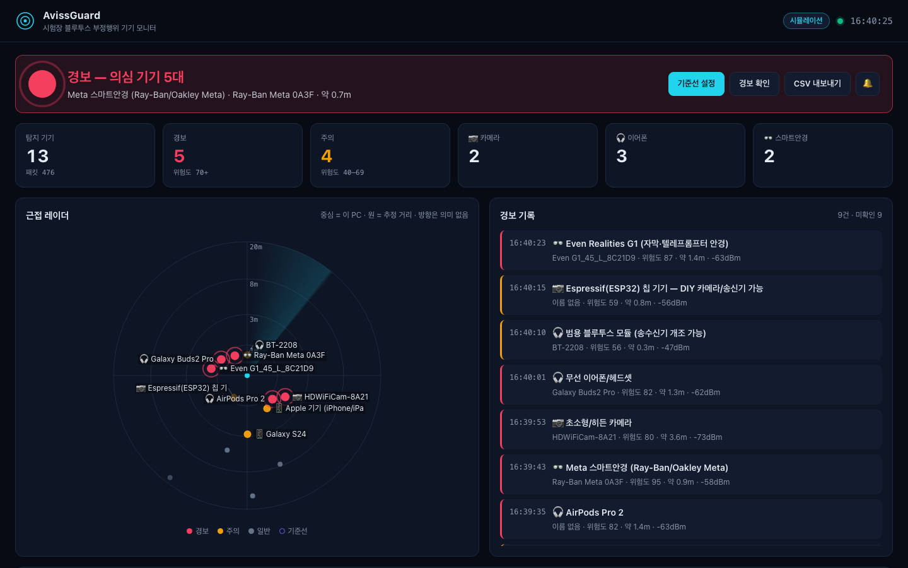

# AvissGuard

시험장 주변의 **블루투스(BLE) 신호를 실시간으로 수신해** 초소형 카메라, 초소형·무선 이어폰, 스마트안경처럼 부정행위에 쓰일 수 있는 기기를 찾아 주는 **모니터링 대시보드**입니다.

노트북 한 대(내장 블루투스)로 바로 돌아가고, 감독관은 브라우저로 경보·근접 레이더·기기 목록을 봅니다.



```
 ┌───────────────┐   BLE 광고   ┌────────────┐   분류·위험도   ┌──────────┐  WebSocket  ┌────────────┐
 │ 주변 기기들    │ ───────────▶ │ bleak 스캐너 │ ─────────────▶ │ Tracker  │ ──────────▶ │ 대시보드    │
 │ 안경·이어폰·캠 │              └────────────┘   (시그니처 DB)  │ + SQLite │             │ (브라우저)  │
 └───────────────┘                                              └──────────┘             └────────────┘
```

## 주요 기능

| 기능 | 설명 |
| --- | --- |
| 실시간 BLE 스캔 | macOS / Windows / Linux에서 [bleak](https://github.com/hbldh/bleak)으로 광고 패킷 수신 |
| 기기 분류 | 이름 패턴, 제조사 ID(Bluetooth SIG), 서비스 UUID, Apple Continuity 메시지로 **카메라·스마트안경·이어폰·웨어러블·휴대기기** 등을 구분 |
| 위험도 점수 (0–100) | 기기 종류 × 신뢰도 + 근접도(RSSI) + 기준선 이후 신규 여부 + 지속 시간 |
| 기준선 (시험 전 스냅샷) | 응시자 입실 전에 눌러 두면 강의실에 원래 있던 기기는 감점, **이후 새로 나타난 기기만 부각** |
| MAC 랜덤화 대응 | 주소가 바뀌어도 이름·모델·제조사로 만든 지문(fingerprint)으로 같은 기기를 인식 |
| 경보 | 위험도 70↑ 경보 / 40↑ 주의 — 화면 배너, 경보음, 브라우저 알림, 기록 저장 |
| 근접 레이더 | 추정 거리를 동심원으로 표시 (방향은 BLE 특성상 알 수 없음) |
| 허용 목록 | 감독관 휴대폰·학교 비품 등을 한 번 눌러 영구 제외 |
| 기록·내보내기 | SQLite에 경보·기기 이력 저장, CSV(엑셀 호환)로 내보내기 |
| 시뮬레이션 모드 | 블루투스 없이 가상 시나리오(AirPods, Ray-Ban Meta, ESP32-CAM 등)로 데모 |

### 탐지 대상 예시 (`avissguard/data/signatures.json`)

- **스마트안경**: Ray-Ban Meta / Oakley Meta, Even Realities G1, XREAL, Rokid, RayNeo, INMO, Vuzix, Solos, Bose Frames, Echo Frames, Huawei Eyewear, Brilliant Labs Frame/Monocle, Meta 제조사 ID(0x01AB, 0x058E)
- **카메라**: HDWiFiCam·V380·LookCam·Yoosee 등 초소형 카메라 앱 계열, ESP32-CAM, GoPro·Insta360·DJI Osmo 등 웨어러블 카메라, Espressif 칩(0x02E5)
- **이어폰**: AirPods/Beats(Apple 근접 페어링 신호 + 모델 식별), Galaxy Buds, Pixel Buds, Sony WF, 저가 TWS(i12, F9 …), Google Fast Pair(0xFE2C), LE Audio, "earpiece/nano/neck loop" 등 커닝용 이어피스 이름, 범용 BT 모듈(HC-05, JDY …)
- **기타 금지 물품**: 스마트워치·밴드, 스마트폰, 태그(AirTag 등)

시그니처는 JSON이라 코드를 몰라도 추가할 수 있습니다. 새로 발견한 기기는 PR로 보내 주세요.

## 빠른 시작

Python 3.10 이상이 필요합니다.

```bash
git clone https://github.com/wnghdcjfe/avissGuard.git
cd avissGuard
python -m venv .venv && source .venv/bin/activate   # Windows: .venv\Scripts\activate
pip install -e .

# 1) 블루투스 없이 데모부터
avissguard --simulate --open

# 2) 실제 스캔
avissguard --open
```

브라우저에서 <http://127.0.0.1:8765> 가 열립니다.

> **macOS**: 처음 실행하면 터미널(또는 iTerm/VS Code)에 블루투스 권한을 묻습니다. 거부했다면 *시스템 설정 → 개인정보 보호 및 보안 → 블루투스*에서 허용하세요.
> 권한이 없으면 macOS가 프로세스를 강제 종료하여 `Abort trap: 6`(종료 코드 134)만 남기고 꺼집니다. 이 경우 위 설정에서 실행 중인 터미널 앱을 추가하고 터미널을 재시작하세요.
> **Linux**: BlueZ가 필요하며, 외장 동글을 쓰려면 `--adapter hci1`.

### 시험장 운영 절차

1. 응시자 입실 **전**, 감독관 노트북을 교실 중앙 또는 교탁에 두고 `avissguard` 실행
2. 신호가 안정되면(약 30초) **기준선 설정** 클릭 → 원래 있던 기기 등록
3. 감독관 본인 휴대폰 등은 목록에서 **허용** 클릭
4. 시험 중 경보가 뜨면 기기를 눌러 근거·RSSI 추이를 확인하고, 노트북을 들고 RSSI가 커지는(-50dBm 이상) 쪽으로 이동해 위치를 좁힘
5. 종료 후 **CSV 내보내기**로 기록 보관

교실이 넓으면 노트북 2대 이상을 서로 다른 위치에 두면 정확도가 올라갑니다.

### 명령줄 옵션

| 옵션 | 기본값 | 설명 |
| --- | --- | --- |
| `--simulate` | | 가상 기기 시나리오로 실행 |
| `--no-scan` | | 스캐너 없이 서버만 실행 |
| `--host` / `--port` | `127.0.0.1` / `8765` | 다른 기기에서 보려면 `--host 0.0.0.0` (인증 없음, 내부망에서만) |
| `--db` | `avissguard.db` | 기록 파일 경로 |
| `--signatures` | 내장 DB | 사용자 시그니처 JSON |
| `--ttl` | `30` | 이 시간(초) 신호가 없으면 화면에서 제외 |
| `--near-rssi` | `-60` | 이 값 이상이면 '매우 가까움' 가점 |
| `--min-rssi` | `-100` | 이보다 약한 신호 무시 (옆 교실 기기 걸러내기, 예: `-85`) |
| `--adapter` | | Linux 블루투스 어댑터 (예: `hci1`) |

## REST / WebSocket API

| 메서드 | 경로 | 설명 |
| --- | --- | --- |
| `GET` | `/api/snapshot` | 현재 활성 기기·통계·위협 수준 |
| `GET` | `/api/alerts?limit=100` | 경보 기록 |
| `POST` | `/api/alerts/ack` | 경보 확인 처리 |
| `GET` | `/api/history` | 지금까지 본 모든 기기 요약 |
| `POST` / `DELETE` | `/api/baseline` | 기준선 설정 / 해제 |
| `GET` | `/api/whitelist` | 허용 목록 |
| `POST` / `DELETE` | `/api/whitelist/{id}` | 허용 목록 추가 / 제거 |
| `GET` | `/api/signatures` | 로드된 시그니처 규칙 |
| `GET` | `/api/export.csv` | 경보·기기 기록 CSV |
| `WS` | `/ws` | 1초마다 스냅샷 + 새 경보 푸시 |

## 위험도 계산

```
기본점수 = 종류 가중치 × 신뢰도 배율
  종류 가중치: 카메라·스마트안경 80, 이어폰 75, 휴대폰·워치 45, 태그 25, PC 20, 미확인 12, 비콘 5
  신뢰도 배율: high 1.0 / medium 0.8 / low 0.55
+ 15  RSSI ≥ -60dBm (매우 가까움)      + 7  RSSI ≥ -72dBm
- 10  RSSI < -88dBm (멀리 있음)
+ 10  기준선 이후 새로 등장           - 40  기준선에 있던 기기
+  5  의심 종류가 1분 이상 지속
허용 목록 → 0점
```
70점 이상 **경보**, 40점 이상 **주의**. 같은 기기는 등급이 올라갈 때만 다시 알립니다.

## 한계 — 꼭 읽어 주세요

이 도구는 **보조 수단**입니다. 탐지되지 않았다고 기기가 없다는 뜻이 아닙니다.

- **BLE 광고만 봅니다.** 클래식 블루투스(BR/EDR)만 쓰는 저가 넥루프·송수신기, **Wi-Fi 전용 초소형 카메라**, 녹화만 하는(무선 없는) 카메라는 보이지 않습니다. 이미 페어링되어 연결 중인 기기는 광고를 멈추기도 합니다.
- 이름을 숨기거나 위장한 기기는 '미확인'으로 분류됩니다. 대신 미확인이라도 가까이서 새로 나타나면 점수가 올라가니 함께 보세요.
- RSSI 기반 거리는 벽·사람 몸·반사로 오차가 큽니다(±수 미터). 위치를 좁히는 용도로만 쓰세요.
- 휴대폰·스마트워치처럼 **허용된 물품까지 잡힐 수 있습니다.** 판단은 항상 감독관이 하세요.
- 금속탐지기, 전파 탐지기(RF 디텍터), 육안 점검과 병행하는 것을 권합니다.

## 법적·윤리적 안내

- AvissGuard는 공중에 송출되는 BLE 광고 신호를 **수신만** 합니다. 기기에 접속하거나 데이터를 가로채지 않습니다.
- **전파 차단(재밍)·방해는 전파법 위반**이며 이 프로젝트의 범위가 아닙니다.
- 수집 기록(기기 이름·주소)은 개인정보가 될 수 있습니다. 시험 관리 목적으로만 쓰고, 보관 기간을 정해 삭제하세요.

## 개발

```bash
pip install -e '.[dev]'
pytest
```

```
avissguard/
├── cli.py              # 명령줄 진입점
├── server.py           # FastAPI (REST + WebSocket + 정적 파일)
├── scanner.py          # bleak BLE 스캐너, 시뮬레이터
├── tracker.py          # 기기별 상태·기준선·허용목록·경보
├── signatures.py       # 시그니처 DB 로딩, 분류, Apple Continuity 파서
├── risk.py             # 위험도·거리 추정
├── store.py            # SQLite
├── data/signatures.json
└── static/             # 대시보드 (빌드 불필요한 HTML/CSS/JS)
```

### 시그니처 추가하기

`avissguard/data/signatures.json`의 `rules`에 항목을 추가합니다. 한 규칙의 조건은 모두 만족해야 하며, 신뢰도가 같으면 먼저 나온 규칙이 이깁니다.

```json
{
  "id": "glasses-new-brand",
  "category": "glasses",
  "label": "새 스마트안경",
  "confidence": "high",
  "name_regex": "(?i)^newglass",
  "company_ids": [1234],
  "service_uuids": ["fe2c"]
}
```

`category`: `camera` · `glasses` · `earpiece` · `wearable` · `phone` · `computer` · `tag` · `infra`

## 라이선스

MIT
